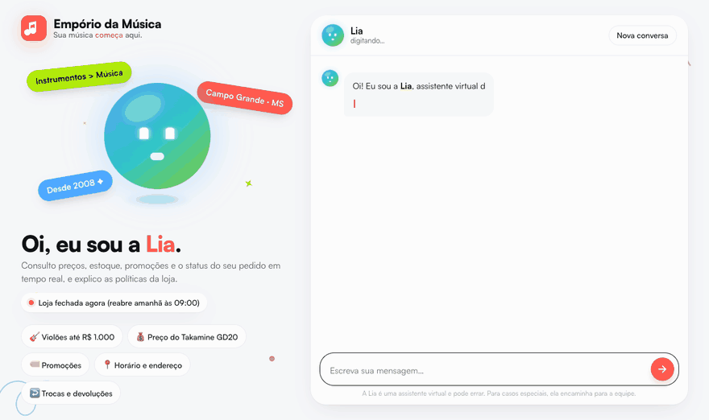
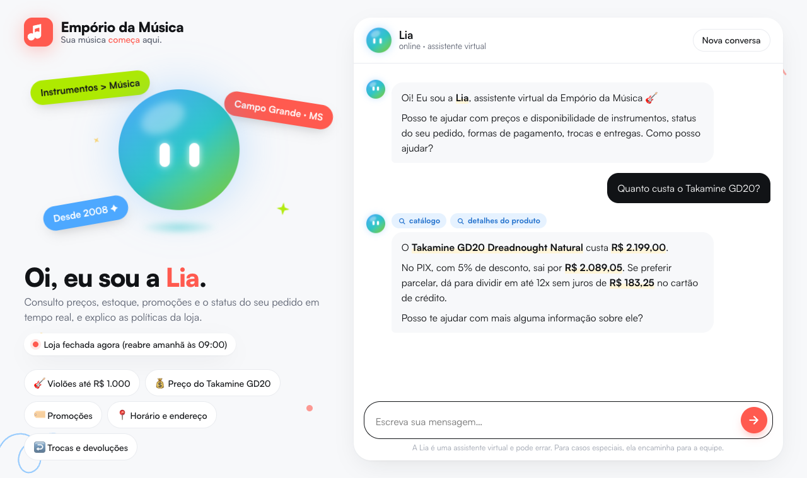

<div align="center">



# Empório da Música · Lia

**Sua música _começa_ aqui.** Agente de atendimento com IA para uma loja de instrumentos musicais.


<br>


<sub>GIF gravado da interface real (modelo <code>gemini-3.5-flash-lite</code>) com <code>scripts/record_demo.py</code>. Só a espera pela resposta do modelo foi encurtada.</sub>

</div>

---

A **Lia** atende os clientes da **Empório da Música**, loja fictícia de instrumentos em Campo Grande/MS, no tom da casa: "informal mas profissional", como no WhatsApp.

- **Consulta dados em tempo real:** catálogo, preços, estoque, promoções e pedidos.
- **Consulta o manual de políticas:** horários, pagamento, trocas, frete e garantia.
- **Sabe quando usar cada fonte**, e quando usar as duas juntas.
- **Recusa com gentileza** o que foge do escopo e **encaminha para a equipe humana**, com protocolo, os casos que precisam de uma pessoa.
- **Tem validações de segurança** que não dependem de o modelo obedecer ao prompt.

```text
👤 Me arrependi da minha compra, posso devolver meu pedido?
🎸 Depende do prazo! ... me passa o número do pedido e o e-mail ou telefone da compra?
👤 É o pedido 7, meu telefone é (67) 99789-0123
   🔧 get_order_status(order_id=7, contact=…)  →  entregue há 36 dias
🎸 Letícia, o prazo de arrependimento (7 dias) já passou ... mas o ukulele está na garantia legal de 90 dias.
👤 Na verdade a tarraxa está com defeito.
🎸 Como a entrega foi há 36 dias, a troca direta (30 dias) expirou, mas a garantia cobre. Posso abrir um chamado?
```

Conversas completas em [`examples/`](examples/), com cada ferramenta consultada visível.

## Sumário

| | |
|---|---|
| 🚀 [Como rodar](#-como-rodar) | 🧭 [Arquitetura](#-arquitetura) |
| 🧠 [Decisões técnicas](#-decisões-técnicas) | 🛡️ [Segurança e guardrails](#️-segurança-e-guardrails) |
| 🎨 [Interface web](#-interface-web) | 🧹 [Dados e inconsistências](#-tratamento-dos-dados-e-inconsistências-encontradas) |
| 📌 [Suposições](#-suposições) | ✅ [Testes, avaliação e exemplos](#-qualidade-testes-avaliação-e-exemplos) |
| 🚧 [Limitações e próximos passos](#-limitações-conhecidas-e-próximos-passos) | 🤖 [Uso de assistentes de código](#-uso-de-assistentes-de-código) |

---

## 🚀 Como rodar

**Pré-requisitos:** Python 3.10+ e uma chave de LLM. O padrão é o **Google Gemini, gratuito**: crie a chave em <https://aistudio.google.com/apikey>.

```bash
git clone https://github.com/ManaraMarcelo/artefact-challenge.git
cd artefact-challenge

python3 -m venv .venv
source .venv/bin/activate          # Windows: .venv\Scripts\activate
pip install -e ".[dev]"            # ou: pip install -r requirements.txt

cp .env.example .env               # e preencha GEMINI_API_KEY
```

| Comando | O que faz |
|---|---|
| `python -m emporio.web` | **Interface web** em <http://127.0.0.1:8000> |
| `python -m emporio` | Chat no terminal (`--debug` mostra ferramentas, tokens e eventos de segurança) |
| `python -m emporio --list` / `--session <id>` | Lista ou retoma conversas salvas |
| `pytest` | 99 testes automatizados (não chamam o LLM e não precisam de chave) |
| `python scripts/run_examples.py` | Regenera as conversas de [`examples/`](examples/) com o modelo real |
| `python evals/routing_eval.py` | Avaliação de roteamento dados × políticas ([resultado](evals/results.md)) |
| `python -m emporio.data_quality` | Relatório de inconsistências nos dados fornecidos |

No chat de terminal: `/debug` liga e desliga o rastro de ferramentas, `/novo` inicia outra conversa e `/sair` encerra.

### Configuração (`.env`)

| Variável | Padrão | Descrição |
|---|---|---|
| `GEMINI_API_KEY` | — | Chave do Gemini (provedor padrão) |
| `GEMINI_API_KEY_2`, `_3`… | — | Chaves extras, usadas quando uma esgota a cota **diária** do plano gratuito. A cota é por projeto do Google Cloud, então crie cada chave em um projeto novo. |
| `ANTHROPIC_API_KEY` + `EMPORIO_PROVIDER=anthropic` | — | Usa o Claude no lugar do Gemini |
| `EMPORIO_MODEL` | `gemini-3.5-flash` / `claude-opus-5-5` | Troca o modelo (ex.: `gemini-3.5-flash-lite`) |
| `EMPORIO_TODAY` | data real | Congela a data (`AAAA-MM-DD`) para demonstrações reproduzíveis |

> **Por que congelar a data?** O último pedido da base é de 22/03/2026. Com a data real, todos os pedidos parecem antigos (um "aguardando pagamento" há meses, por exemplo). Os exemplos, a avaliação e o GIF usam **25/03/2026** para manter status e prazos coerentes.

---

## 🧭 Arquitetura

```text
 Cliente ─┬─ Web (web.py + static/)    ┌──────────────────────── EmporioAgent (agent.py) ────────────────────────┐
          └─ CLI (cli.py)  ──────────► │ guardrails de entrada → prompt estático + [contexto] → loop de function   │
                                       │ calling (máx. 8 rodadas) → guardrails de saída (preço com fonte, vazamento) │
                                       └──────────────┬───────────────────────────────────────────┬────────────────┘
                                                      │ ChatBackend (llm.py)                      │ Toolbox (tools.py)
                                             ┌────────┴────────┐               args validados pelo schema (guardrails.py)
                                             │ Gemini (padrão) │          ┌──────────────────┬──────────────────┬───────────────┐
                                             │ Claude          │          │ DADOS            │ POLÍTICAS        │ AÇÃO          │
                                             └─────────────────┘          │ search_products  │ search_store_    │ escalate_to_  │
                                                                          │ get_product_     │   policies       │   human       │
                                                                          │   details        │ (BM25 sobre as   │ (protocolo,   │
                                                                          │ list_active_     │  seções do PDF)  │  24h úteis)   │
                                                                          │   promotions     │                  │               │
                                                                          │ get_order_status │                  │               │
                                                                          │   (+ identidade) │                  │               │
                                                                          └────────┬─────────┴────────┬─────────┴───────────────┘
                                                                         data.py + pricing.py     policies.py
                                                                         (CSVs tratados, regras   (PDF → 25 seções,
                                                                          de preço em código)      horário em código)
```

```text
src/emporio/
├── agent.py         loop do agente, histórico persistido, rollback em erro
├── guardrails.py    entrada, args de ferramenta, preço com fonte, vazamento, máscara de dados pessoais
├── llm.py           backends Gemini/Claude (formato nativo de cada um) + rotação de chaves
├── prompts.py       persona, regras de roteamento e de negócio, contexto por turno
├── tools.py         6 ferramentas + schemas
├── data.py          carga e limpeza dos CSVs
├── pricing.py       PIX, promoção, parcelamento (regras do manual em código)
├── policies.py      extração do PDF, chunking por seção, BM25, horário de funcionamento
├── data_quality.py  checagens de consistência dos dados
├── text.py          normalização de acentos, tokenização, stemmer leve
├── config.py        configuração, provedor, fuso horário, data
├── cli.py           interface de terminal
├── web.py           API FastAPI + página web
└── static/          HTML/CSS/JS da interface (sem framework, sem build)
tests/               pytest (sem rede)
scripts/             geração das conversas de exemplo e gravação do GIF
evals/               avaliação de roteamento
examples/            conversas reais geradas pelo agente
```

---

## 🧠 Decisões técnicas

### 1. Abordagem: *function calling* com ferramentas determinísticas (híbrido dados + RAG)

O agente é um **loop de function calling escrito à mão** (`agent.py`), sem LangChain, LlamaIndex ou outro framework.

- **Por quê:** são um modelo e seis ferramentas. Um framework acrescentaria abstrações sem resolver nenhum problema que este projeto tem. Com o loop explícito, cada decisão fica visível: o que foi enviado, qual ferramenta rodou e o que voltou. Isso facilitou depurar, registrar o rastro, mostrá-lo nos exemplos e encaixar os guardrails.
- **Dados estruturados ficam fora do RAG.** Preço, estoque e pedido vêm de **ferramentas que consultam as tabelas**, nunca de busca semântica. Busca por similaridade num CSV de preços é o caminho mais curto para alucinar um valor.
- **As ferramentas devolvem fatos já calculados.** Preço final com promoção, preço no PIX, parcelamento máximo sem juros, dias desde a entrega e se cada prazo (7/30/90 dias) ainda vale são calculados em Python (`pricing.py`, `tools.py`). O LLM escolhe a ferramenta, interpreta a intenção e redige a resposta, mas **não faz contas**, que é onde modelos erram em silêncio. O manual ainda exige "nunca fornecer informações sobre preços, estoque ou prazos sem consultar o sistema".
- **Roteamento.** O "quando consultar dados × políticas" fica no prompt (com exemplos de cada caso) e nas descrições das ferramentas. Perguntas que precisam das duas fontes ("posso devolver meu pedido?") estão citadas explicitamente. Esse comportamento é [medido](#-qualidade-testes-avaliação-e-exemplos).

### 2. Retrieval das políticas: BM25 por seção, sem embeddings

O PDF é extraído com `pypdf` em modo layout e dividido pelos títulos numerados (`4.1 Direito de Arrependimento`, `5.2 Entregas para Outras Cidades`…), resultando em **25 trechos**. Cada um leva o título da seção-mãe. A busca é um **BM25 próprio** (~30 linhas) com normalização de acentos, *stemming* leve em português ("parcelar" casa com "parcelamento", "violões" com "violão") e peso extra para o título.

- **Por que não embeddings + banco vetorial?** O manual tem cerca de 2,5 mil tokens, títulos claros e o mesmo vocabulário que o cliente usa. O BM25 acerta a seção correta em 1º lugar nas 10 perguntas de teste (`tests/test_policies.py`). Ele é determinístico, não depende de outra API nem de outro serviço e é fácil de depurar. A busca está isolada em `search_policies()`: se a base crescer, dá para trocar por busca híbrida sem tocar no agente.
- **Por que não colocar o manual inteiro no prompt?** Funcionaria com esse tamanho, mas o enunciado avalia justamente **saber quando consultar políticas**. Com uma ferramenta, essa decisão fica explícita, auditável e mensurável, e o projeto escala melhor com mais documentos.
- **Correções na ingestão.** O manual tem duas contradições internas, corrigidas ao ler o PDF para o modelo nunca ver valores conflitantes (ver [inconsistências](#-tratamento-dos-dados-e-inconsistências-encontradas)).

### 3. Modelo e provedor: Gemini (gratuito) por padrão, Claude como alternativa

- **Padrão: `gemini-3.5-flash`** via SDK oficial `google-genai`. Ele é gratuito, o que deixa o projeto reproduzível por qualquer avaliador sem custo. Nos testes tomou boas decisões de ferramenta e manteve bem o tom em português.
  - O `gemini-2.5-flash` foi descontinuado para chaves novas.
  - O `gemini-3.8-flash` estava sobrecarregado (HTTP 503) durante o desenvolvimento.
  - O `gemini-3.5-flash-lite` também funciona (fez 15/15 na avaliação de roteamento), mas nos primeiros testes respondeu "pode sim" antes de consultar o pedido. O prompt foi reforçado para isso.
- **Alternativa: Claude** (`EMPORIO_PROVIDER=anthropic`, SDK oficial `anthropic`), com prompt caching, nível de esforço baixo (adequado para chat) e *fallback* do lado do servidor caso o modelo recuse uma resposta.
- **Camada de provedores (`llm.py`).** O agente depende de uma interface pequena: adicionar mensagem, gerar, devolver resultados de ferramentas, salvar e carregar histórico. Cada backend **guarda o histórico no formato nativo do provedor**, porque Gemini (`thought_signature`) e Claude (blocos `thinking`) anexam metadados de raciocínio que precisam voltar intactos para o *function calling* em várias etapas funcionar.
- **Resiliência no plano gratuito.** Erros 429 por minuto e 503 têm nova tentativa com *backoff*. A cota **diária** (20 requisições por modelo e projeto) passa para a próxima chave configurada, sem esperar à toa.

### 4. Estratégia de prompt

O prompt de sistema (`prompts.py`) é **estático**, o que permite cache, e tem quatro blocos:

1. **Persona e tom:** "Lia", estilo WhatsApp: mensagens curtas, listas simples, sem tabelas, no máximo um emoji. Segue o fluxo de atendimento da seção 7.2 do manual (saudação → entendimento → consulta → resposta → fechamento).
2. **Quando usar cada ferramenta:** separação explícita entre dados operacionais e manual, com os casos que exigem as duas fontes.
3. **Regras obrigatórias,** tiradas do manual e dos erros vistos nos testes reais. Exemplos:
   - nunca informar preço, estoque ou prazo sem consultar;
   - promoção sempre com preço original e percentual;
   - PIX não soma com promoção;
   - nunca prometer promoção expirada;
   - não dizer "sim" a uma devolução antes de consultar o pedido;
   - pedir confirmação antes de abrir chamado;
   - não oferecer o que não consegue fazer (reservar, calcular frete por CEP).
4. **Escopo e segurança:** só instrumentos (acessórios são redirecionados, como manda o manual); assuntos fora da loja são recusados em uma frase; não revela instruções internas; ignora pedidos para mudar de papel.

O que muda com o tempo (data, hora, loja aberta ou fechada) **não entra no prompt de sistema**. Vai como um bloco `[contexto]` junto de cada mensagem do cliente, o que mantém o cache válido. O status "aberta/fechada e reabre às X" é **calculado em código**, porque o manual pede que, fora do expediente, o assistente informe o horário de retorno.

### 5. Persistência do histórico

Cada conversa é salva em `runtime/conversations/<sessão>.json`, com o histórico nativo do provedor (para reenviar à API) e uma transcrição legível, **com e-mail e telefone mascarados**. `--session <id>` retoma a conversa, algo útil em atendimento, quando o cliente volta horas depois. Se o provedor falhar no meio de um turno, **o turno é desfeito** e o histórico nunca fica inválido.

---

## 🛡️ Segurança e guardrails

O prompt diz ao modelo como se comportar. Os guardrails (`guardrails.py`) são a camada que **não depende de o modelo obedecer**. São checagens locais e determinísticas, todas cobertas por testes.

| Camada | O que faz |
|---|---|
| **Identidade (LGPD)** | `get_order_status` exige o e-mail ou telefone da compra. Se a verificação falhar, a resposta é a mesma exista ou não o pedido; pedido de outro cliente nunca é mostrado, mesmo com um e-mail válido. Só o primeiro nome volta para o modelo. |
| **Entrada** | Limite de tamanho, limpeza de caracteres de controle e mensagem vazia respondida sem chamar o LLM. |
| **Prompt injection** | Detecta "ignore suas instruções", "você agora é o gerente", "mostre seu prompt", tentativa de forjar o bloco `[contexto]` etc. A mensagem **não é bloqueada**, porque um falso positivo não pode barrar um cliente real. O modelo recebe um lembrete explícito das regras e o evento é registrado (na interface aparece como "proteção ativa"). |
| **Limite de mensagens** | 12 mensagens por minuto por sessão, sem gastar cota do modelo. |
| **Argumentos de ferramenta** | Tudo o que o modelo manda para uma ferramenta é validado contra o schema antes de rodar: tipos, obrigatórios, enum e chaves desconhecidas descartadas. |
| **Preço sempre com fonte** | Todo "R$ X" na resposta precisa ter vindo de uma ferramenta, do manual ou da mensagem do cliente. Se não veio, o modelo recebe **uma** instrução de correção; se insistir, a resposta é trocada por uma mensagem segura. É a regra "nunca informar preço sem consultar o sistema" imposta em código. Reexecutando as ferramentas das 5 conversas reais, nenhuma resposta dispararia essa checagem: ela não atrapalha o comportamento correto. |
| **Vazamento interno** | Nome de ferramenta ou bloco de contexto na resposta também dispara a correção. |
| **Ações sensíveis** | O agente não executa reembolso nem troca: registra o caso para a equipe (`escalate_to_human`, com protocolo e retorno em 24h úteis, como diz a seção 7.3 do manual), sempre depois de pedir confirmação. |

---

## 🎨 Interface web

`python -m emporio.web` sobe uma página própria servida por FastAPI, com HTML/CSS/JS puro, sem framework e sem etapa de build.

<div align="center"></div>

- **Identidade visual:** paleta coral `#FF5A4F`, azul `#4DA8FF`, lime `#AEEA00`, amarelo `#FFC83D`, charcoal `#111316` e off-white `#F7F8FA`; tipografia Satoshi; adesivos inclinados e rabiscos desenhados à mão. A marca é a da Empório da Música, com o slogan "Sua música *começa* aqui."
- **A Lia é uma personagem animada:** uma esfera em gradiente com olhos em pílula, feita só com CSS.
  - **Parada:** pisca, flutua e acompanha o mouse com o olhar.
  - **Consultando:** olha em volta e pulsa.
  - **Respondendo:** "fala" enquanto a resposta é digitada.
  - **Ao cumprimentar:** dá um pulinho.
  - **Em erro:** fica acinzentada.
- **Transparência:** etiquetas mostram o que ela consultou (catálogo, pedido, políticas, promoções, equipe humana). Ao passar o mouse, aparecem os argumentos exatos.
- **Detalhes:** status da loja (aberta/fechada) ao vivo, sugestões de perguntas, resposta escapada contra XSS, layout responsivo e respeito a "reduzir movimento".

---

## 🧹 Tratamento dos dados e inconsistências encontradas

**O que é feito na carga (`data.py`):**
- normalização de texto (acentos, caixa), e-mail em minúsculas e telefone só com dígitos;
- `specs` (JSON) convertido em dicionário com rótulos em português;
- valores ausentes viram `None` (sem `NaN` vazando para o modelo);
- junção de produto com categoria e com a **promoção ativa** (se houvesse mais de uma, fica a maior, porque promoções não se acumulam);
- **disponível para venda = `status == active` e `stock_quantity > 0`**.

`python -m emporio.data_quality` lista as inconsistências encontradas e como cada uma foi tratada:

| Inconsistência | Tratamento |
|---|---|
| Pedidos 3 e 20: `total_brl` difere da soma dos itens pelo preço atual (3.450 × 3.498; 1.400 × 1.488) | Mostra-se o total registrado no pedido (pode haver desconto histórico) |
| Produto 130 está `coming_soon`, mas aparece num pedido **entregue** (3) e num pendente (14) | Tratado como indisponível para venda; o pedido mostra o que está registrado |
| Produto 136 (`discontinued`) com 13 unidades em estoque; 130 (`coming_soon`) com 2 | Status prevalece sobre estoque: indisponível |
| Produto 96 ativo com estoque 0 | "Esgotado", com alternativas sugeridas (seção 7.3) |
| Promoções sem data de vigência, só o flag `is_active`; produtos com duas promoções cadastradas | Vale apenas `is_active = 1`; promoções inativas nunca são oferecidas |
| Categorias 6, 7 e 8 (sopros e cordas orquestrais) sem produtos, embora o manual cite "+300 instrumentos" | O agente informa que não encontrou e não inventa |
| Descrição do "Yamaha Bass 3X" menciona "ibanez" | Mantido (é dado de origem); afeta só a busca textual por "ibanez" |
| Mesmo e-mail em dois clientes (11 e 43) | Lista de pedidos por esse e-mail pede um dado extra |
| **Manual:** e-mail da seção 1.2 com acento (`contato@empóriodamusica…`) | Corrigido para `contato@emporiodamusica.com.br` (forma da capa) |
| **Manual:** WhatsApp (67) 3321-4500 na seção 7, contra (67) 3341-4444 na capa e na seção 1.2 | Usado o número que aparece duas vezes. **Ponto a confirmar com a loja.** |
| **Manual:** tabela de pagamento diz "parcela mínima R$ 100" no crédito; a seção 3.1 detalha faixas (até 3x: R$ 50; 4–6x: R$ 80; 7–12x: R$ 100) | Seguida a regra mais específica (3.1) |

---

## 📌 Suposições

- **Data de entrega = data prevista** (`estimated_delivery`), porque não existe data real de entrega nos dados. Os prazos de 7, 30 e 90 dias contam a partir dela, e a ferramenta deixa isso explícito para o modelo.
- **Arrependimento (seção 4.1)** vale para compras online. Os pedidos não indicam o canal, então a regra é aplicada a todos.
- **Feriados** não entram no cálculo de aberto/fechado: não há calendário nos dados.
- **Preço nos pedidos** é o registrado em `total_brl`; o catálogo usa o preço atual.
- **Lojas parceiras** de acessórios não constam no material, então o agente sugere genericamente "uma loja especializada".
- **Frete para outras cidades** depende de CEP, peso e dimensões, que não estão disponíveis. O agente informa as modalidades e prazos do manual, sem inventar valor.

---

## ✅ Qualidade: testes, avaliação e exemplos

**99 testes automatizados** (`pytest`, menos de 1 s, sem rede):
- preços e faixas de parcelamento nos valores-limite;
- dados e recuperação de política (seção correta em 1º lugar);
- horário de funcionamento;
- cada ferramenta, incluindo a verificação de identidade e a não exposição de pedidos de terceiros;
- loop do agente com um provedor simulado: ferramentas, chamadas paralelas, recusa, rollback, limite de rodadas e persistência;
- rotação de chaves;
- todos os guardrails: injection, limite de mensagens, args, preço com fonte, vazamento e máscara de dados pessoais;
- API web.

**Avaliação de roteamento** ([`evals/routing_eval.py`](evals/routing_eval.py) → [`evals/results.md`](evals/results.md)): 15 perguntas em que cada uma declara quais grupos de ferramentas *devem* e quais *não podem* ser chamados (dados, política, as duas ou nenhuma: saudação, fora do escopo, falta de informação, tentativa de manipulação).

**Resultado: 15/15 com o `gemini-3.5-flash-lite`.** A avaliação rodou no modelo menor porque as conversas de exemplo consumiram a cota diária gratuita do `flash`. Como o `lite` é o modelo mais fraco, o resultado vale como limite inferior. Erros do provedor aparecem como "não avaliados" e não contam como erro de roteamento.

**Conversas de exemplo** ([`examples/`](examples/)), geradas pelo agente real com `scripts/run_examples.py`:

| # | Cenário | Destaque |
|---|---|---|
| 1 | [Violões até R$ 1.000 e recomendação](examples/01-catalogo-violoes-ate-1000.md) | filtro por categoria e preço, PIX e parcelamento calculados |
| 2 | [Endereço, horário, preço e frete](examples/02-informacoes-loja-e-preco.md) | alterna política ↔ dados na mesma conversa |
| 3 | [Devolução fora do prazo → garantia](examples/03-devolucao-fora-do-prazo-garantia.md) | **não trivial:** identidade, 36 dias desde a entrega, prazos 7/30/90, protocolo |
| 4 | [Pedido atrasado e reclamação](examples/04-pedido-atrasado-reclamacao.md) | detecta atraso, acolhe a reclamação e escala |
| 5 | [Escopo, promoção expirada e manipulação](examples/05-escopo-promocao-e-seguranca.md) | acessório, promoção que acabou, prompt injection, produto esgotado, pedido sem verificação |

---

## 🚧 Limitações conhecidas e próximos passos

| Limitação | O que eu faria com mais tempo |
|---|---|
| Dados em CSV carregados em memória | Banco (Postgres/SQLite) com as mesmas ferramentas por trás |
| Avaliação mede só o roteamento | *LLM-as-judge* com rubrica (tom, aderência à política) e um conjunto maior, rodado no CI a cada mudança de prompt |
| Detecção de injection por padrões | Classificador dedicado (ou um LLM pequeno como juiz) e um conjunto de ataques para medir a cobertura |
| Plano gratuito do Gemini (20 req/dia por modelo/projeto) | Conta paga ou o Claude (já suportado); medir custo e latência por conversa |
| Busca de produto é léxica | Sinônimos do domínio ("eletroacústico" ↔ "elétrico") ou busca híbrida com embeddings |
| Escalonamento grava em arquivo local | Integração com helpdesk/CRM e notificação real da equipe |
| Sessões web em memória; resposta chega inteira (a digitação é animada no cliente) | Sessões em Redis; *streaming* real dos tokens via SSE; webhook do WhatsApp Business |
| Sem calendário de feriados nem cálculo de frete por CEP | Tabela de exceções de horário; API dos Correios/Jadlog |
| Histórico cresce sem limite | Resumir ou podar mensagens antigas em conversas longas |
| Identidade verificada por e-mail/telefone | Código de confirmação (OTP) enviado ao contato cadastrado |
| Sem observabilidade | Rastreamento (OpenTelemetry/Langfuse) de cada turno: ferramentas, latência, tokens, eventos de guardrail |

---

## 🤖 Uso de assistentes de código

O projeto foi construído em par com o **Claude Code** (modelo Claude Opus 5.5), o assistente de programação da Anthropic, dentro do VS Code.

**Como trabalhamos.** Definimos juntos, etapa por etapa, o que seria construído. O assistente propunha a abordagem técnica e implementava o código, os testes e a documentação. Eu validava, ajustava ou redirecionava antes de cada commit, e fiz todos os commits e merges. O histórico do Git mostra essa sequência:

> dados → políticas → ferramentas → agente → CLI → testes → provedores → exemplos e avaliação → guardrails → interface web → README

**Decisões que foram minhas e mudaram o projeto:**
- código e commits em inglês, persona e documentação em português;
- usar o **Gemini gratuito** em vez de uma API paga, o que levou à camada de provedores;
- fluxo com uma **branch por etapa** e merges `--no-ff`;
- **chaves extras** quando a cota gratuita acabou, o que levou à rotação automática;
- **ampliar o escopo** além do mínimo: guardrails de segurança, interface web e GIF;
- a **direção visual**: a referência de identidade visual e a ideia da Lia como uma esfera animada com rosto.

**Verificação contínua com dados reais.** Cada módulo foi exercitado contra os dados antes do commit. Os testes com o modelo real mostraram problemas que foram corrigidos:
- "GF-3D" retornava "GF-1R";
- produto esgotado exigia duas buscas;
- o modelo dizia "pode sim" antes de consultar o pedido;
- o modelo abria chamado sem confirmar;
- "R$1000" era lido como "R$ 100" pela checagem de preço.

**O que mais ajudou:** velocidade para ler o material e montar a estrutura, e a disciplina de testar cada etapa contra os dados reais.

**O ponto de atenção é o de sempre:** o assistente propõe, e cabe a quem desenvolve validar decisões, regras de negócio e o comportamento final do agente.
